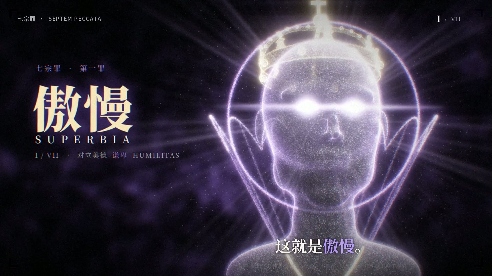
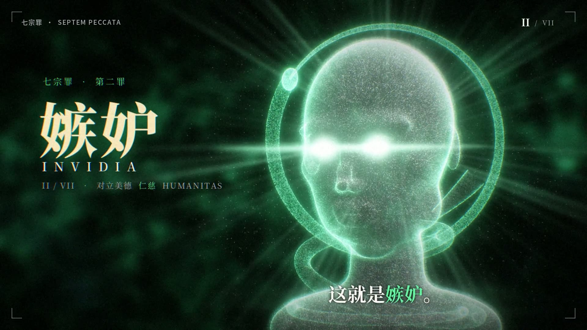
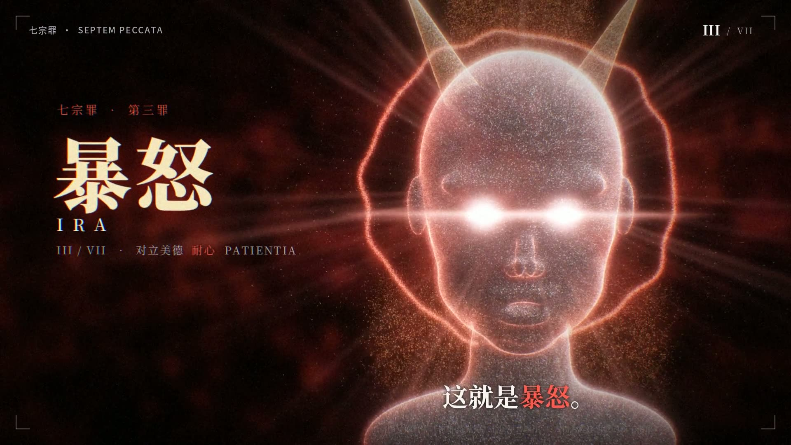
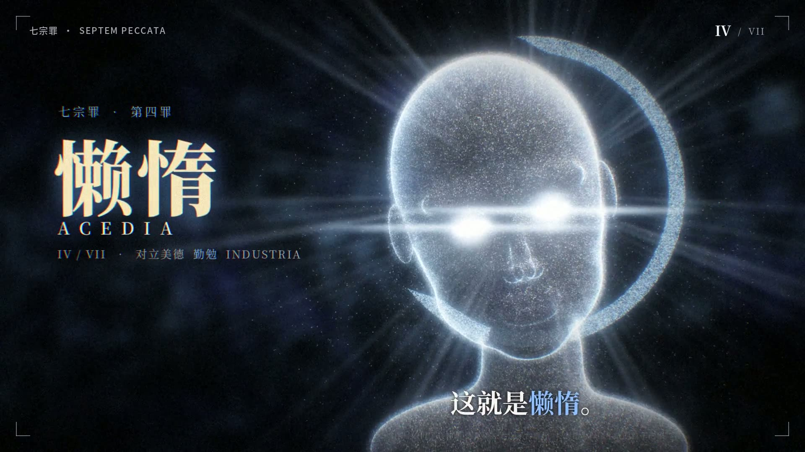
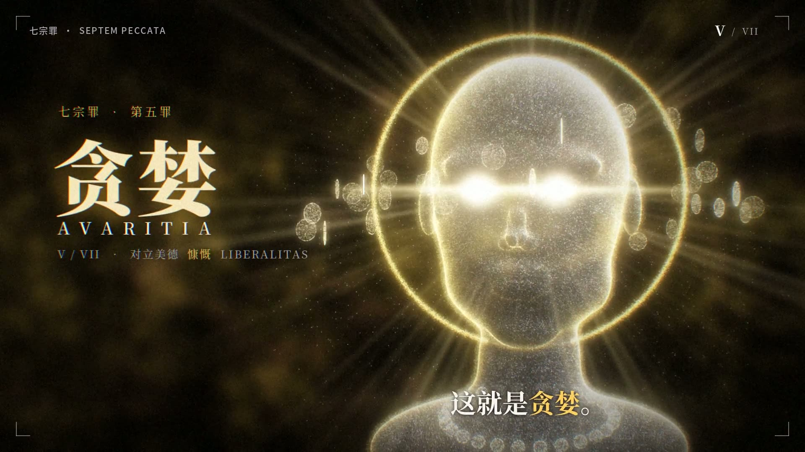
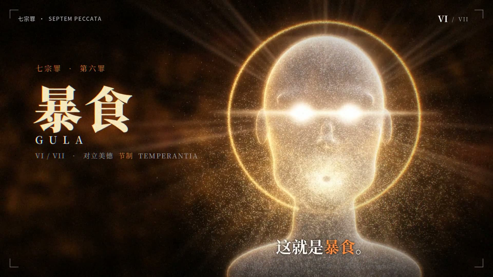

# 七宗罪视频

「七宗罪」七部曲抖音视频生成器——全程序化粒子人头+卡点抖动/故障/冲击波特效。纯代码生成，无外部素材——画面与音效**全部由程序合成**（鼓点、呼啸、冲击波、故障音按90 BPM节拍网格混成，无需外挂BGM）；`web/videos/` 附7条效果成品，可直接播放。

为《七宗罪》制作的程序化粒子特效短视频，配有节拍同步的视觉效果和合成音效。采用 MIT 许可协议。

**志哥AI出品 · 完全开源免费**

<p align="center">
  
  
  <br>
  
  
  <br>
  
</p>

## 使用教程

### 1. 环境准备（一次性）

- Python 3.10+，命令行执行 `pip install -r requirements.txt`
- 安装 **ffmpeg**（命令行能运行 `ffmpeg -version` 即可）
- 一份 **Noto CJK 字体**（思源黑体/宋体，.ttc 格式）。Linux 默认查找 `/usr/share/fonts/opentype/noto/`；Windows/macOS 下载后放到任意目录，并设置环境变量 `SINS_FONT_DIR` 指向该目录

### 2. 一键出片

```bash
cd scripts && ./render_all.sh
```

7 条视频并行渲染（每条约 3 分钟），输出到 `scripts/out/`，**程序合成的音效已自动混入**。Windows 请在 Git Bash 里运行；也可以逐条渲染（见下）。

### 3. 单条渲染 / 快速预览

```bash
cd scripts
python3 make.py pride --preview 0.5,5.3,9      # 先出 3 张静帧快速检查（秒级）
python3 make.py pride --out work/pride.mp4     # 渲染完整一条（约 3 分钟）
```

七个罪的 key：`pride` 傲慢 / `envy` 嫉妒 / `wrath` 暴怒 / `sloth` 懒惰 / `greed` 贪婪 / `gluttony` 暴食 / `lust` 色欲。预览静帧输出在 `work/pv_*.png`。

### 4. 网页播放器

双击 `web/index.html`（无需服务器），把渲染出的 mp4 放进 `web/videos/`（或直接拖进页面）即可自动连播；页面上能一键复制每条的发布标题和话题标签。

### 5. 让画面特效跟着你的音乐（可选）

视频自带程序合成的音效，不配音乐也能直接发布。若想让**视觉卡点**跟随你自己的音乐：

```bash
cd scripts
python3 audio_fx.py 你的音乐.wav    # 预计算节拍/起音包络到 work/audio_fx.npz
./render_all.sh                      # 再渲染，闪白/抖动/切镜会跟着这首歌走
```

## 文案（提示词）怎么写

所有文案都集中在 `scripts/sins_data.py`——`SINS` 列表里每个 dict 就是一条视频的完整内容，**改字段就能换文案、换配色、换主题，不用动任何渲染代码**：

| 字段 | 作用 |
|---|---|
| `cn` / `latin` / `roman` / `nth` | 罪名：中文 / 拉丁文 / 罗马数字 / 第几罪（字卡大标题） |
| `virtue_cn` / `virtue_lat` | 对立美德，显示在字卡罪名下方 |
| `lineA` / `lineB` | 开场两句话（先闭眼句、后睁眼句）；格式 `[["文本", None], ["关键词", "kw"], …]`，标 `"kw"` 的片段会用主题色高亮 |
| `words` | DROP 段依次弹出的六个四字词 |
| `title` | 发布标题，网页播放器里可一键复制 |
| `theme` / `accent` / `kw` | 主题色 / 点缀色 / 关键词高亮色（RGB 0–1 浮点，`kw` 用 hex） |
| `pose` / `mouth` / `eyes` | 头部姿态（pitch/yaw/roll）与表情强度 |

写作口诀：`lineA` 一句平铺直叙，`lineB` 一句补刀反转；`words` 用四字词最有力量；`title` 沿用「我同时发布了七宗罪，你分配到了『XX』！」句式；七个罪的排列顺序按但丁《神曲·炼狱篇》七层平台。

**把 SKILL.md 当 AI 提示词用**：`SKILL.md` 本身就是写给 AI 的完整提示词（时间轴、六幕场景、字段含义、文件结构都写清了）。把它和 `sins_data.py` 一起发给 AI，再说一句「帮我把七宗罪换成 XX 主题的七部曲」，AI 就能批量改写文案、配色和关键词——你只需要重新渲染出片。

## 🪄 一键复刻提示词

想让别人（或另一个 AI）**一键部署出和这一模一样的项目并直接出片**？把下面这段提示词原样发给任意 AI 编程助手（Claude / ChatGPT / ZCode 等）即可；也可以直接把 [PROMPT.md](PROMPT.md) 文件发给它。提示词会让 AI **先从 GitHub 完整部署代码、自检通过后，再渲染出全部 7 条成品视频**。想换主题，在提示词末尾加一句「主题改成 XX，按同样结构重新设计七个罪的文案、配色与标志物」。

```text
请帮我完整部署并复刻这套「七宗罪」七部曲抖音短视频生成器。
代码仓库：https://github.com/rhfbgfgfdg999999/seven-sins-video
（MIT 协议；全部画面与音效由程序生成，不使用任何外部图片 / 视频 / 音频素材）

【第一步：完整部署代码（必须先做，先不渲染）】
1. 克隆仓库：git clone https://github.com/rhfbgfgfdg999999/seven-sins-video.git
2. 安装依赖：pip install -r requirements.txt（numpy scipy opencv-python pillow），
   并确认命令行能运行 ffmpeg -version
3. 准备 Noto CJK 字体（思源黑体/宋体 .ttc）：Linux 默认查找
   /usr/share/fonts/opentype/noto/，其他平台设置环境变量 SINS_FONT_DIR 指向字体目录
4. 核对工程结构：scripts/（make.py 渲染、sfx.py 音效、sins_data.py 全部文案等）、
   web/（index.html 播放器 + videos/ 成品）、references/copy.md、LICENSE（MIT）
5. 部署自检：cd scripts && python3 make.py pride --preview 0.5,5.3,9
   —— 能秒级输出 3 张静帧（work/pv_*.png）即部署成功

【第二步：出片（部署自检通过后再执行）】
1. 全部渲染：cd scripts && ./render_all.sh
   —— 7 条并行（每条约 3 分钟），程序合成的音效自动混入，输出到 scripts/out/
2. 单条渲染：python3 make.py pride --out work/pride.mp4
3. 把成品放进 web/videos/，双击 web/index.html 自动连播；页面可一键复制每条的
   发布标题与话题标签
4. 最终交付：01_傲慢 02_嫉妒 03_暴怒 04_懒惰 05_贪婪 06_暴食 07_色欲，
   共 7 条 1920×1080、30fps、18 秒成品，可直接发布抖音

【这套程序的细节参考（排查问题时用）】
- 画面：粒子人头（SDF 隐式建模 → 表面点采样 → 加性双线性点溅射渲染），
  暗场 + 主题色辉光；每罪专属标志物（傲慢=王冠、嫉妒=毒蛇、暴怒=双角、
  贪婪=金币雨、暴食=旋涡、色欲=花瓣，懒惰主题另配）
- 时间轴按 ~90.25 BPM 节拍网格（BEAT=0.6648s，B0=-0.055s，DROP 第 8 拍 ≈5.26s）：
  阵容 → 推近闭眼 → riser → 屏息 → DROP+三次硬切 → 变身 → 字卡（罪名+拉丁文+
  罗马数字+对立美德）→ 六个四字词逐拍弹出 → 冲击波 → 淡出
- 文案字段集中在 scripts/sins_data.py 的 SINS 列表：cn/latin/roman/nth、
  virtue_cn/virtue_lat、lineA/lineB（"kw" 片段主题色高亮）、words（六个四字词）、
  title（发布标题）、theme/accent/kw（配色）、pose/mouth/eyes；改字段即可换主题
- 音效由 scripts/sfx.py 程序合成（每拍底鼓、DROP 低音 boom、呼啸 riser、切镜
  whoosh、词 zap、和弦 stab、冲击波 sweep、hi-hat/clap），与画面同一节拍网格，
  make.py 自动混入；想让视觉特效跟随自己的音乐：python3 audio_fx.py 音乐.wav 后再渲染
- 渲染确定性（固定随机种子），同一命令两次渲染画面一致

【质量要求】
- 部署阶段不要改动任何渲染逻辑与文案；出片阶段如遇报错，先按仓库 README
  的「使用教程」排查
- 严格按顺序执行：先完成第一步部署自检，再进入第二步出片
```

详见 [SKILL.md](SKILL.md)。发布标题与标签见 `references/copy.md`。
